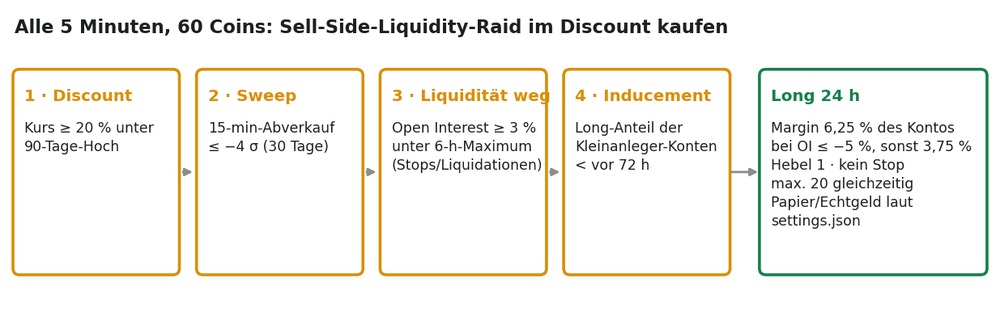
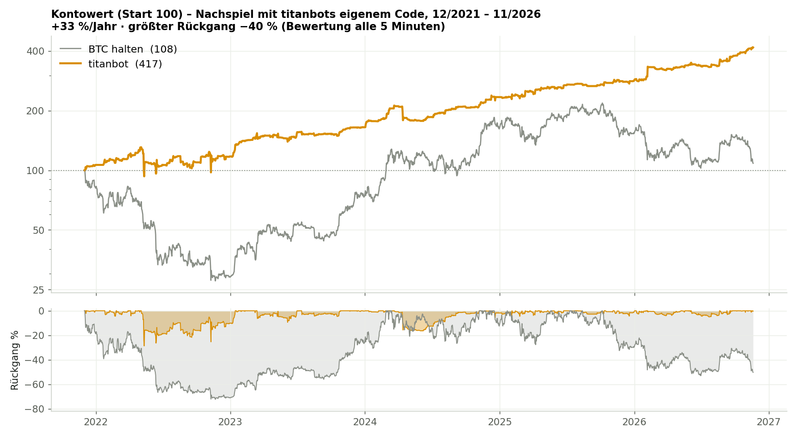
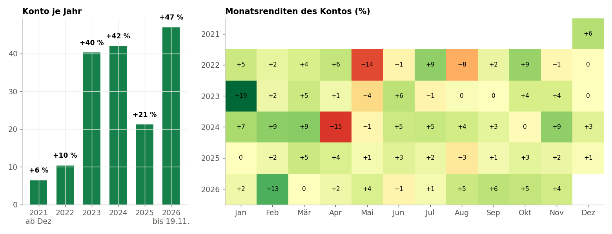
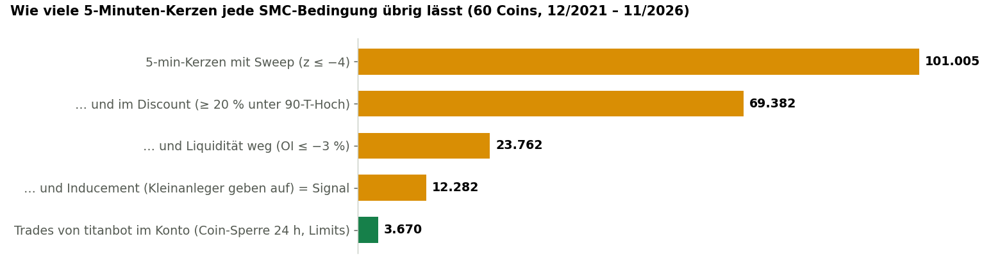
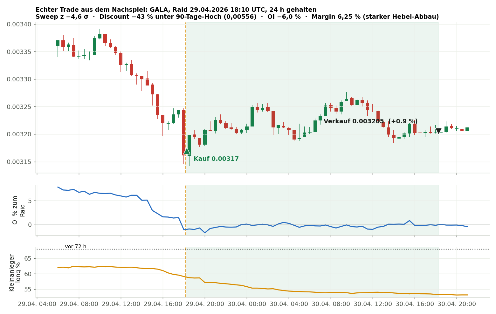

# titanbot – SMC-Raid

**Kauft den Sell-Side-Liquidity-Raid im Discount**, aber nur, wenn echte Daten zeigen, dass Liquidität eingesammelt wurde.
Alle 5 Minuten, 60 Coins, Bitget USDT-M, Papier/Echtgeld-Schalter wie beim jaegerbot.

| SMC-Baustein | Messung (Binance-Daten, öffentlich) |
|---|---|
| Discount | Kurs ≥ 20 % unter dem 90-Tage-Hoch |
| Sell-Side-Sweep | 15-min-Abverkauf z ≤ −4 (Rendite / Schwankung der letzten 30 Tage) |
| Liquidität eingesammelt | Open Interest ≥ 3 % unter dem 6-h-Maximum (Stops und Liquidationen ausgelöst) |
| Inducement | Anteil long positionierter Kleinanleger-Konten kleiner als vor 72 h |
| Einstieg / Ausstieg | Long zur nächsten Minute nach Kerzenschluss, raus nach 24 h, kein Stop (Hebel 1) |
| Größe | 6,25 % des Kontostands bei starkem Hebel-Abbau (OI ≤ −5 %), sonst 3,75 %; höchstens 20 gleichzeitig |



## Ergebnisse (01.12.2021 – 19.11.2026, mit titanbots eigenem Code nachgespielt, Kontobewertung alle 5 Minuten)

| | Ende (Start 100) | pro Jahr | größter Rückgang |
|---|---:|---:|---:|
| **titanbot (60 Coins, Hebel 1)** | **417** | **+33 %** | **−40 %** |
| davon 06/2024 – 11/2026 | | +41 % | −35 % |
| BTC halten (gleicher Zeitraum) | 109 | +2 % | −74 % |



Im Nachspiel stehen 3.670 Trades (≈ 740 pro Jahr, 55 % Treffer, im Mittel +0,86 % je Trade nach Kosten und Funding).
1.230 davon mit 6,25 % Margin bei starkem Hebel-Abbau, 2.440 mit 3,75 %, keine Liquidation. Auf den 30 Coins, die bei der Entwicklung
nie benutzt wurden, sind es 2.165 Trades mit +0,82 %, auf den 30 Entwicklungs-Coins 1.505 mit +0,91 %. Jedes Kalenderjahr ist positiv.
Der größte Rückgang (−40 %) fiel in den LUNA-Crash im Mai 2022.



### Wie selten das Signal ist

Von gut 101.000 Sweep-Kerzen bleiben nach allen vier SMC-Bedingungen 12.282 übrig. Daraus macht die Coin-Sperre (24 h je Coin)
zusammen mit den Konto-Grenzen 3.670 Trades. 423 Signale fielen weg, weil schon 20 Positionen offen waren, und 115, weil die Kasse fehlte.
Das sind die Momente, in denen viele Coins gleichzeitig raiden.



### Ein typischer Trade

Ein echter Trade aus dem Nachspiel mit einem Ergebnis nahe am Median (gelb gestrichelt = Raid-Kerze, grün = 24 h Haltedauer).
Der Kurs fällt im Sweep, das Open Interest bricht weg (Liquidität eingesammelt), und der Long-Anteil der Kleinanleger liegt unter dem Wert von vor 72 h.



**Nachspiel:** `tools/nachspiel.py` führt die Bot-Funktionen selbst (`pruefbar`, `kauf`, `exits`, `markt.Konto`) Ereignis für Ereignis
auf den historischen Binance-Daten aus. Ersetzt werden nur die Datenquellen. Ausführung wie live eine Minute nach Kerzenschluss, gleichzeitige
Signale nach Kerze und Coin. Unterschied zu live: Kurse von Binance statt Bitget. Die 30 Entwicklungs-Coins kennen die Regel aus der Forschung,
die Größenregel wurde auf ihnen gewählt. Die 30 frischen Coins zeigen dasselbe Bild.

## Warum diese Form (Forschung 21.11.2026, Claude + Codex)

`botprojekte/forschung/2026-11-21-smc-neu` (Präregistrierungen, Ideen und Prüfberichte von Codex, Skripte):

- **titanbot v1** (SMC-Kerzenmuster + Optuna je Coin) hatte keine Kante: Die „Gewinner“-Configs reproduzierten nicht. Der alte Code
  liegt im Git-Tag `v1-smc-alt`.
- **Runde 1:** 13 SMC-Ideen mit echten OI-/Taker-Daten (Sweeps gleicher Hochs/Tiefs, FVG, gefangene Ausbrecher, Funding, Paare)
  → 0/13; auf 5m/≤24 h liegen sie brutto bei ≈ 0.
- **Raid im Discount** (= kapbot-Kapitulationsregel) auf **30 nie benutzten Coins**: +1,28 %/Trade netto (alle Signale), p 0,0005,
  29/30 Coins und jedes Jahr 2021–2026 positiv. Das ist die vierte unabhängige Bestätigung.
- **SMC-Feinschliff** (Sweep+Rückeroberung, FVG-Limit, Ausstieg an Buy-Side-Liquidität, Wochen-Sweeps, früherer 1m-Einstieg) → alle
  schlechter. Wer auf Bestätigung wartet, verpasst den Rebound.
- **Größe nach OI-Abbau** (Codex) auf frischen Coins bestanden: 32,4 %/J, −38,9 % (Forschungsrechnung), mit doppelten Kosten 26,1 %/J.
- **Hebel:** Hebel 2 bringt in der Forschung ~50 %/J bei ~−70 % Rückgang, Hebel 3 durch Liquidationen weniger. Tageslimits und
  BTC-Absicherung kosten mehr Rendite, als sie Rückgang sparen. Die Raids im Pulk (≥ 10 in 24 h) sind im Mittel die besten Trades
  (+3,8 %), laufen aber gemeinsam erst weiter nach unten.

## Schalter (`settings.json`)

| Schalter | Standard | Wirkung |
|---|---|---|
| `echtgeld.aktiv` · `papier_startkapital` | **aus** · 200 | aus = Papierhandel mit echten Bitget-Kursen, Spread, Gebühren, Funding (Konto `data/papier/konto.json`, Telegram „📝 PAPIER“); an = echte Orders über `secret.json` → `titanbot` (Konto `data/echtgeld`). Je Lauf neu gelesen, Wechsel wird gemeldet, offene Positionen des anderen Modus schließen trotzdem regulär. `update.sh` behält deine Einstellung. |
| `titanbot.aktiv` · `einsatz_oi_stark` · `einsatz_normal` · `hebel` · `max_offen` | an · 0,0625 · 0,0375 · 1 · 20 | aus = keine neuen Trades, offene laufen aus |

**Kontogröße:** mindestens ~135 USDT. Sonst liegen normale Trades (3,75 %) unter Bitgets Mindestwert von 5 USDT und werden übersprungen.

**kapbot:** kapbot handelt dieselbe Regel auf 30 dieser Coins. Beide mit Echtgeld auf demselben Konto wären doppeltes Risiko,
und die Positionen desselben Symbols würden sich mischen. Wenn beide laufen, dann auf getrennten Bitget-Unterkonten.

## `secret.json` (nicht im Git)

```json
{
  "titanbot": [{"apiKey": "...", "secret": "...", "password": "..."}],
  "telegram": {"bot_token": "...", "chat_id": "..."}
}
```
Für Papier reicht `telegram`. Ein leerer `apiKey` gilt als „kein Zugang“.

## Installation auf dem Mini-PC

```sh
git clone https://github.com/Youra82/titanbot.git ~/botprojekte/titanbot && cd ~/botprojekte/titanbot
./install.sh            # .venv, Dienst titanbot.timer (alle 5 min, 1 min nach Kerzenschluss)
sudo systemctl start titanbot.service ; journalctl -u titanbot -n 40
```
Der erste Lauf lädt 90 Tage 5m-Kerzen für 60 Coins nach (≈ 15–20 min, ≈ 25 MB in `data/`), danach dauert jeder Lauf wenige Sekunden.
Bericht: `.venv/bin/python -m titanbot bericht` · Update: `./update.sh`.

## Echtgeld-Absicherung (Codex-Review 21.11.2026, zwei Prüfrunden)

- **Kein Doppelkauf:** Jede Order hat eine feste clientOid (aus dem Signal bzw. fortlaufend), die zusammen mit der reservierten Margin **vor**
  dem Senden gespeichert wird. Nach Netzfehler oder Absturz schlägt der nächste Lauf genau diese Order nach und bucht die gefüllte Menge.
  Eine unauffindbare Order wird erst nach 15 min, 3 leeren Abfragen und ohne unerklärte Börsenmenge freigegeben, sonst kommt eine Warnung.
- **Keine falsche Liquidation:** Zuerst wird die eigene Close-Order nachgeschlagen. Fehlt Menge ohne eigenen Close, gilt das erst nach
  10 min als Liquidation. Bereits realisierte Teil-Closes zählen dabei mit.
- **Gebucht wird die tatsächliche Füllung** (Menge, Kurs, Gebühren, Funding). Order-IDs werden nur einmal gebucht, und Vormerkungen zählen zu `max_offen`.
- **Fehler isoliert:** Ein Fehler im Kontoabgleich oder bei einem Ausstieg blockiert die übrigen Ausstiege nicht. Ohne gesicherte
  Echtgeld-Initialisierung gibt es keine Einstiege, und ohne Zugang laufen die Papier-Ausstiege weiter.
- **Fremde Positionen** auf demselben Bitget-Konto werden einmal am Tag gemeldet. Trotzdem gilt: **eigenes Unterkonto je Bot.**
- `update.sh` wartet auf einen laufenden Takt und pausiert den Timer bis zum Ende des Updates.
- Bewusste Grenzen: Das Konto ist ein Buchwert (offene Gewinne zählen erst beim Ausstieg), und Funding wird aus den Bitget-Sätzen des
  Haltefensters berechnet. Eine aggregierte Symbolposition, die mit einem anderen Bot geteilt wird, ist nicht sauber zuzuordnen.

## Cockpit

`cockpit.json` meldet das Papierkonto (`data/papier/konto.json`, Format wie evobot, Takt 5 min, ohne SL).

## Prüfungen

- `PYTHONPATH=src python -m unittest discover -s tests`: offline, keine Netz- oder Order-Aufrufe
- `python tools/parity_signale.py`: Live-Regel gegen alle 4.208 Forschungssignale der 60 Coins (exakt gleich)
- `python tools/nachspiel.py`: Konto 12/2021–11/2026 mit dem Bot-Code (Ergebnis oben, ≈ 15 min)
- `python tools/readme_grafiken.py`: erzeugt die Bilder in `docs/images/` aus dem Nachspiel (Desktop, braucht pandas + matplotlib)
